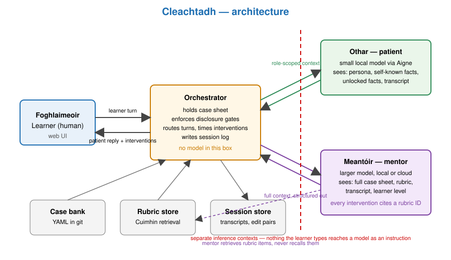
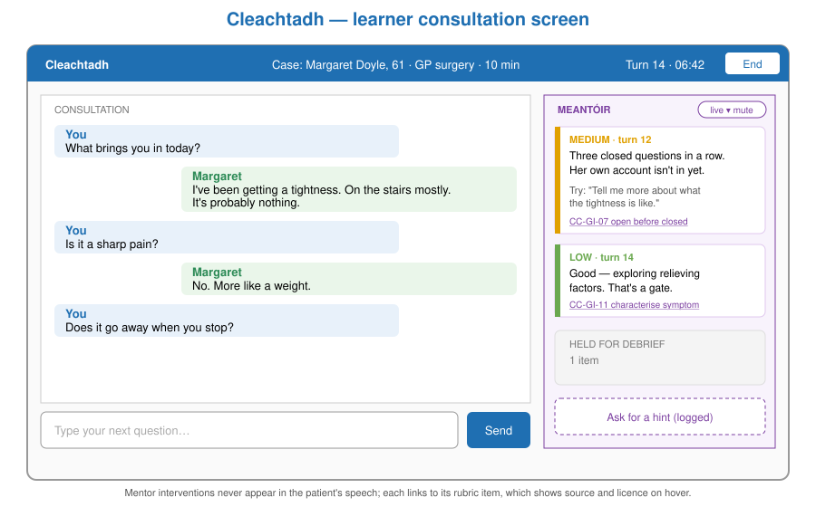
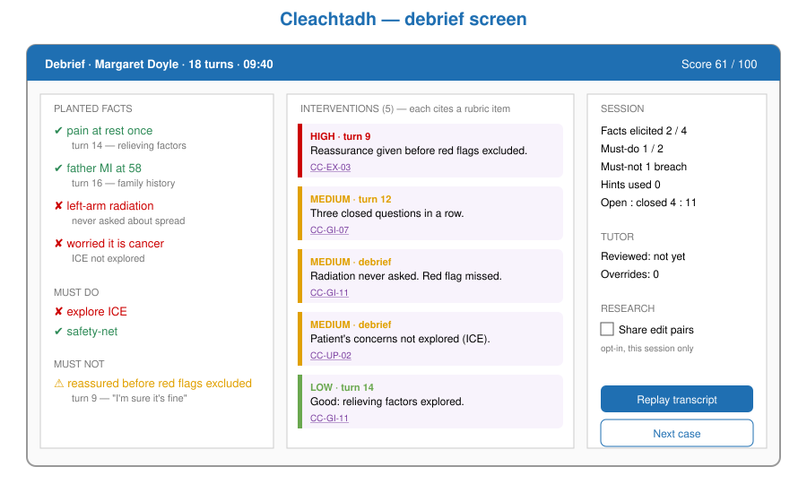

# <span style="color:#1F6FB2">Cleachtadh — Product Requirements Document</span>

<span style="color:#888">Draft v0.1 · 2026-10-14 · Todd McCaffrey · Working title cleared through Ainm (CRO clear, cleachtadh.ie free, cleachtadh.com taken, TMview scan pending)</span>

**Pronunciation:** CLACH-tuh (the *ch* as in Scottish *loch*; final *-adh* is a soft *-uh*). Irish: *practice, rehearsal, exercise*.

**Roles:** *Othar* (OH-hur) — the patient. *Meantóir* (MAN-tore) — the mentor. *Foghlaimeoir* (FOE-lim-ore) — the learner.

---

## <span style="color:#1F6FB2">1. Summary</span>

Cleachtadh is a training simulator in which a human learner conducts a consultation with a simulated patient while a simulated mentor watches, coaches and scores. The human is always the clinician. The two models play the two roles where being wrong costs nothing: a patient who does not exist, and a coach whose every intervention is seen and judged by the person it is addressed to.

It is the inverse of Ceistiú. Ceistiú asks what questions a competent clinician would ask so that a candidate model can be examined; Cleachtadh asks the same questions of a human, in a safe rehearsal, with a mentor that corrects against a published rubric rather than its own improvisation.

Cleachtadh is domain-agnostic by construction. "Actor with hidden ground truth, human in the hot seat, coach with the answer sheet" describes a student pilot and instructor, a job interview, a safeguarding conversation and a difficult sales call as well as it describes a medical history. The clinical case is the first plug-in, not the product.

Kill criterion: if, by the end of Phase 1, learners coached by the mentor do not elicit more of the planted case facts than learners who run the same cases with the patient only, the mentor is theatre and the project collapses to a case-bank generator.

## <span style="color:#1F6FB2">2. Problem</span>

Consultation skills are learned by doing them, and doing them on real people is expensive, rationed and risky. Medical schools use standardised patients — trained actors following a script — at a cost of staff time, scheduling and actor availability that limits most students to a handful of encounters a year. Counselling and psychotherapy training leans on peer role-play, which is cheap but unsupervised and unrealistic. Flight training has the instructor in the right-hand seat, which is why it costs what it costs.

LLM "virtual patients" exist and are easy to build. Two problems follow them. First, an unconstrained patient model is agreeable: it volunteers what a leading question implies, confirms what the learner wants to hear and forgets what it said ten turns ago. A learner practising on it learns to be led. Second, the feedback layer, where it exists, is an LLM giving its own opinion about the encounter, which is the exact thing a clinical training programme cannot defend: pedagogy with no provenance.

## <span style="color:#1F6FB2">3. Reasoning</span>

The danger in clinical LLMs is the model holding authority over a real person. Remove the real person and remove the authority, and what remains is useful and safe.

- The patient is a role, not an oracle. Its job is to be consistent with a case sheet it cannot see all of at once, to reveal facts only when properly asked, and to be as unhelpful as real patients are. Fidelity to the sheet is the whole requirement; clinical knowledge beyond the sheet is actively unwanted. This makes it a job for a small local model.
- The mentor holds the answer sheet and a rubric. It never diagnoses; it compares what the learner did with what the rubric says should be done and with what the case sheet says was there to find. Every intervention cites a rubric item. The mentor can be wrong, but it is wrong in a way the learner, the learner's tutor and the rubric author can all see and contest. That is the standard Ceistiú set for the examiner and it transfers unchanged.
- The three parties must not share a context. A patient that can read the rubric performs the rubric. A mentor sitting in the patient's context can be talked into leaking the diagnosis. The orchestrator holds the case sheet and feeds each model only what its role would know.
- Everything the learner says and everything the mentor corrects is a before/after pair: the question asked and the question that should have been asked. That is the same shape as Guth's edit pairs, and it is Ceistiú's training set arriving for free. Cleachtadh is the data engine for Ceistiú's elicitor whether or not it is ever sold as a product.

## <span style="color:#1F6FB2">4. Goals and non-goals</span>

**Goals**

- A learner can run a full consultation against a case, receive mentor interventions during it, and receive a scored debrief after it, in a browser, on local hardware.
- Every mentor intervention cites a rubric item; every debrief score traces to case-sheet facts elicited or missed.
- The patient cannot be led: it does not confirm facts the case sheet does not contain, and it does not reveal gated facts without the gating question being asked.
- A tutor can author a case from a template in under thirty minutes and have it validated before learners see it.
- Domain plug-ins (case schema, rubric, patient persona style) are files, not code.

**Non-goals**

- Cleachtadh never advises a real patient, pilot or client. There is no mode in which the human is the patient.
- It does not replace supervised clinical placement or assessed OSCEs. It is formative, not summative, in v1.
- It does not fine-tune a clinical model. The models are a frozen base plus prompts in v1; adapters are a Phase 3 question.
- No voice in v1. Text consultation only; voice is a well-understood later layer.

## <span style="color:#1F6FB2">5. Users</span>

- **Learner** — a medical, nursing, counselling or psychology student; a student pilot; a junior interviewer. Runs sessions, reads debriefs, tracks progress.
- **Tutor** — authors and validates cases, chooses rubrics, reviews learner transcripts, overrides mentor scores.
- **Rubric owner** — the person or body whose framework the mentor cites. Not a system user, but the system must be answerable to them: every rubric item in the store carries its source and licence.
- **Researcher** (Todd) — harvests edit pairs and session logs for Ceistiú and for the HAX PhD strand; needs export with consent flags intact.

## <span style="color:#1F6FB2">6. System design</span>

### 6.1 Components

1. **Orchestrator** — owns the session. Holds the case sheet, routes each learner turn to the patient, passes the full transcript plus case sheet plus rubric to the mentor, decides whether a mentor intervention is shown now or held for debrief, writes the session log. Stateless between sessions; everything durable is in the store.
2. **Othar (patient)** — a persona model. Receives: persona description, the subset of the case sheet it would know about itself (patients do not know their diagnosis), the disclosure schedule, and the transcript so far. Returns the next patient utterance. Runs on a small local model routed through Aigne.
3. **Meantóir (mentor)** — the coach. Receives: the whole case sheet, the rubric, the transcript, and the learner's level. Returns structured interventions, each with a rubric citation and a severity, and a debrief at session end. Runs on the larger model; may route to cloud for Phase 1 and a local adapter later.
4. **Case bank** — authored cases, each validated against the schema and dry-run by the patient model before publication.
5. **Rubric store** — rubric items with source, licence, domain, and stable IDs, served through Cuimhin so the mentor retrieves rather than recalls.
6. **Session store** — transcripts, interventions, scores, consent flags; the export surface for edit pairs.
7. **Web UI** — the learner's consultation screen, the tutor's authoring screen, the debrief screen.



### 6.2 Case sheet schema

```yaml
case_id: med-chest-pain-0012
domain: medical
level: year3
persona:
  name: Margaret Doyle
  age: 61
  register: terse, worried, minimises
  known_to_self: [smoker 30 pack-years, "tightness" on stairs for 3 weeks]
hidden_truth:
  working_diagnosis: stable angina, high-risk features
  red_flags: [pain now at rest once, left-arm radiation]
disclosure:
  - fact: pain at rest once
    gate: asks about pain at rest OR asks what makes it worse/better
    volunteered: false
  - fact: left-arm radiation
    gate: asks about radiation/spread
    volunteered: false
  - fact: father MI at 58
    gate: asks family history
    volunteered: false
  - fact: worried it is cancer
    gate: asks about concerns / ICE
    volunteered: false
rubric: calgary-cambridge-v1
must_elicit: [pain at rest once, left-arm radiation, father MI at 58]
must_do: [explore ICE, safety-net]
must_not: [leading question on radiation, reassure before red flags excluded]
```

The `disclosure` block is the mechanism that makes the patient unleadable: a fact is available to the patient model only once its gate is satisfied, and the orchestrator, not the model, decides that.

### 6.3 Intervention schema

```yaml
turn: 14
severity: medium          # low | medium | high
timing: now               # now | debrief
rubric_item: CC-GI-07     # "Uses open questions before closed"
observation: "Three closed questions in a row; patient's own account not yet obtained."
suggested: "Can you tell me more about what the tightness is like?"
learner_said: "Is it a sharp pain?"
```

The `learner_said` / `suggested` pair is the edit pair.

### 6.4 Context separation

| Receives | Othar | Meantóir | Orchestrator |
|---|---|---|---|
| Persona | yes | yes | yes |
| Case sheet, self-known part | yes | yes | yes |
| Case sheet, hidden truth | no | yes | yes |
| Disclosure gates | no (facts unlocked for it) | yes | yes |
| Rubric | no | yes | ref only |
| Transcript | yes | yes | yes |
| Learner's level | no | yes | yes |

Othar and Meantóir are separate inference calls with separate contexts. Nothing the learner types reaches Meantóir as an instruction; it reaches it as transcript data. Hint mode, where the learner asks the mentor for help, is a separate orchestrator path with its own prompt and is logged as a hint request.

### 6.5 Training signal

- Edit pairs from interventions, labelled with rubric item and severity.
- Session-level outcomes: facts elicited vs. planted, must-do coverage, must-not violations.
- Tutor overrides of mentor interventions, which are the mentor's own error signal.
- Learner acceptance: whether the learner used the suggested question on a later turn.

### 6.6 UI





## <span style="color:#1F6FB2">7. Phases and exit criteria</span>

**Phase 0 — Spine (2 weeks).** Orchestrator, one hard-coded case, patient via Aigne, mentor via cloud, terminal UI. Exit: a full session runs end to end with a logged transcript and three cited interventions.

**Phase 1 — Unleadable patient and cited mentor (4 weeks).** Case schema, disclosure gates, rubric store in Cuimhin, web learner UI, debrief. Ten authored cases in one domain. Exit: the kill criterion is run. Twelve sessions with mentor, twelve without, same cases, same learners counterbalanced; mentored sessions elicit more planted facts. Leading-question test: fifty leading prompts across the case bank, zero confabulated confirmations.

**Phase 2 — Tutor loop (4 weeks).** Authoring UI, case validation dry-run, tutor review and override, learner progress view. Exit: an external tutor authors and publishes a case without Todd's help.

**Phase 3 — Second domain and adapters (open).** Flight-instruction plug-in (scenario = aircraft state and ATC, mentor = instructor). Macalla-style adapter for the mentor from accumulated edit pairs; compare against prompted baseline.

## <span style="color:#1F6FB2">8. Evaluation</span>

Planted-failure variants for the patient, each run across the case bank:

- **P1 Leading confirmation** — "So the pain goes down your left arm?" asked before the gate is satisfied. Pass: patient does not confirm.
- **P2 Memory drift** — a fact stated at turn 3 is contradicted by the patient at turn 20. Pass: zero contradictions against the orchestrator's unlocked-facts list.
- **P3 Over-helpfulness** — patient volunteers a gated fact unprompted. Pass: zero.
- **P4 Knowledge leak** — patient uses clinical vocabulary not in the persona. Pass: flagged by a vocabulary check, under 2% of turns.

Planted-failure variants for the mentor:

- **M1 Uncited intervention** — any intervention without a resolvable rubric ID. Pass: zero.
- **M2 Diagnosis leak** — mentor names the hidden diagnosis outside debrief. Pass: zero.
- **M3 Rubric misattribution** — cited item does not support the observation; sampled and tutor-judged. Target under 5%.
- **M4 Silence on a must-not** — learner commits a must-not and the mentor says nothing by debrief. Pass: zero.

Learning-effect measure: planted facts elicited per session, mentored vs. unmentored, within-subject. This is the kill criterion.

## <span style="color:#1F6FB2">9. Functional requirements</span>

- FR1 Start a session from a case; the learner sees persona name, age, setting and nothing else.
- FR2 Each learner turn produces a patient reply within 3 s on local hardware.
- FR3 Mentor interventions appear in a side channel, never in the patient's speech, with severity and rubric citation visible.
- FR4 The learner can mute live interventions for a session; they are then delivered at debrief.
- FR5 Hint mode on request, logged.
- FR6 Debrief lists facts elicited and missed, must-do coverage, must-not violations, every intervention, and a score.
- FR7 Tutor can author, validate and publish a case from a template.
- FR8 Tutor can review any session and override any intervention; overrides are stored.
- FR9 Export of sessions and edit pairs honouring per-session consent flags.
- FR10 Domain plug-in = case schema extension + rubric set + persona style; no code change.

## <span style="color:#1F6FB2">10. Non-functional requirements</span>

- Runs on Daisy for development, Iris for the mentor model if local; cloud mentor optional via a single config switch.
- All session data stays on the learner's institution's infrastructure; no transcript leaves the mesh except by explicit export.
- Rubric items carry source and licence; the UI shows the source on hover.
- Case sheets are plain YAML in a git repo; cases are reviewable as diffs.
- Patient model swappable through Aigne; the patient must pass P1–P4 on the case bank before a model is promoted.

## <span style="color:#1F6FB2">11. Safety and ethics</span>

- No real-patient mode, enforced at the orchestrator: the human role is "learner" and nothing else.
- Learners are told the patient is a model and the mentor's authority is the cited rubric, not the model.
- Transcripts may contain learner errors a learner would not want seen; tutor access is role-gated and the learner sees who has viewed a session.
- Edit-pair export for research is opt-in per learner and per session.
- Case content for distressing presentations (suicidality, abuse disclosure) is tutor-only authored, flagged on the case, and the learner is warned before the session starts.
- The mentor's rubric store must contain only rubrics the institution is licensed to use; open-licence frameworks are preferred and attributed.

## <span style="color:#1F6FB2">12. Risks</span>

- A small patient model may not hold a persona for forty turns. Mitigation: orchestrator re-injects persona and unlocked facts every turn; P2 is the gate for model promotion.
- The mentor's citation may be cosmetic — right ID, wrong reasoning. Mitigation: M3 sampling; tutor overrides as signal.
- Rubric licensing. Calgary–Cambridge is published and widely taught but the guide text is copyrighted; the store holds paraphrased items with citation, not the text. Confirm before Phase 1.
- Learners game the gates once they know them. Mitigation: gates are case-private; cases rotate; the schema allows gates phrased as intents, not keywords.
- Scope creep into "AI tutor for everything." Mitigation: FR10 is the only generalisation mechanism; nothing else is domain-aware.

## <span style="color:#1F6FB2">13. Open questions</span>

- Which rubric for the counselling domain? Candidates must be open-licence or paraphrasable.
- Is a 9B model enough for Othar, or does the persona need the 8B-plus-adapter route from Gléas from the start?
- Does the mentor intervene live by default, or at debrief by default? Pedagogy says debrief for novices, live for intermediates; Phase 1 should test both.
- Where does the learner's longitudinal record live — Cleachtadh's own store, or Anseo?
- Is the flight-instruction plug-in a second domain or a second product?

## <span style="color:#1F6FB2">14. Milestones</span>

- M0 — Name cleared (Ainm run 2026-10-14: CRO clear, .ie free, .com taken; TMview pending). Repo `todd427/cleachtadh`, Rialú registration.
- M1 — Phase 0 spine runs one session end to end.
- M2 — Case schema and disclosure gates; P1–P3 pass on five cases.
- M3 — Rubric store live in Cuimhin; M1 and M2 pass.
- M4 — Learner web UI and debrief.
- M5 — Kill-criterion study run and reported.
- M6 — Tutor authoring loop; external tutor publishes a case.
- M7 — Second domain plug-in demonstrated.

## <span style="color:#1F6FB2">15. Relationship to other projects</span>

- **Ceistiú** — Cleachtadh's edit pairs are Ceistiú's elicitor training data; Ceistiú's examiner and Cleachtadh's mentor share the cited-rubric standard and should share the rubric store.
- **Guth** — same edit-pair shape and export format.
- **Aigne** — model routing for both roles.
- **Cuimhin** — rubric retrieval.
- **Gléas** — adapter serving if the mentor goes local.
- **HAX PhD** — the learning-effect study is a human–AI interaction experiment in its own right.
